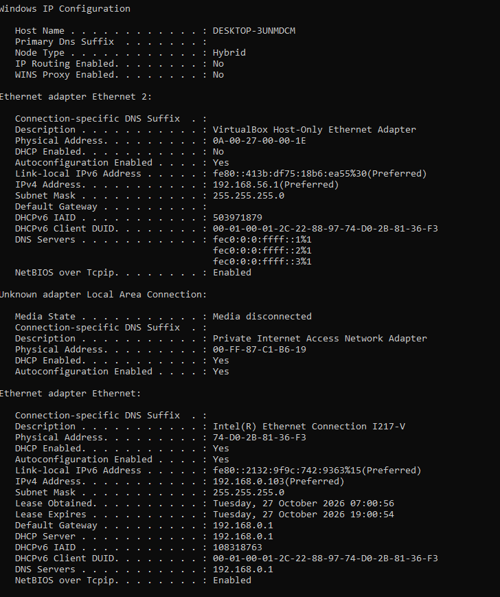
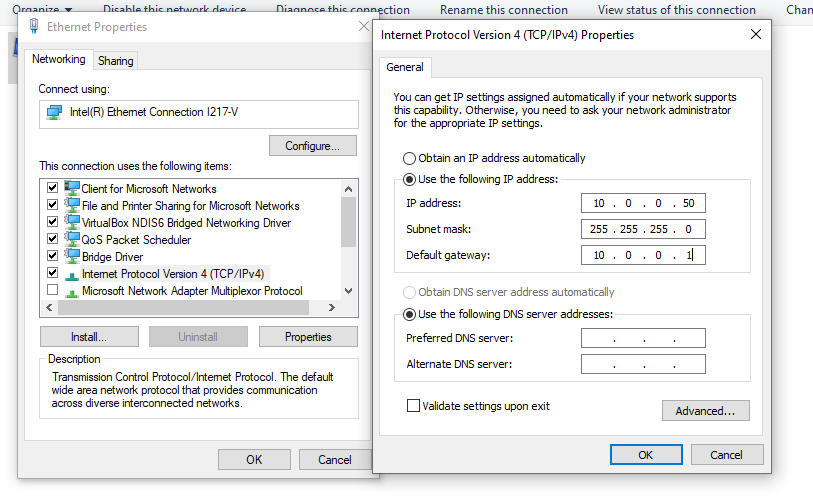
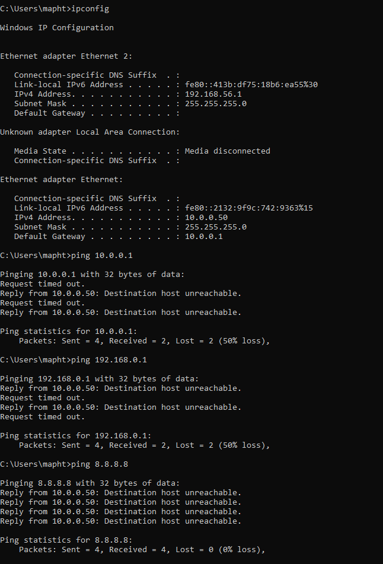
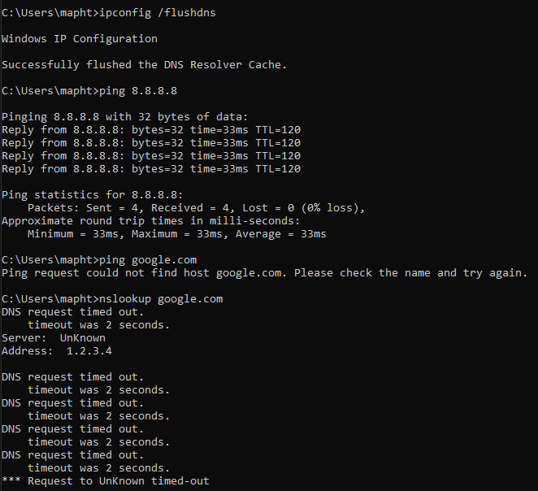

# "My internet doesn't work": a beginner's guide to finding out why

This is one of the most common tickets in IT support. It sounds vague, but a few commands can show you where the problem is within minutes. In this guide, you'll learn three quick ways to check a connection, and how to read the results. To show what each fault looks like, I broke my own connection on purpose in my home lab.

## Before you even consider anything else

**Is it just you, or everyone?** If the whole office is offline, the problem most likely lies with the router or the provider, not the individual computer.

If it's only on your end, cable and Wi-Fi should be your go-to. First check you're on the right network. If that's correct, make sure both ends of the cable are plugged in and the port light is on. It sounds obvious, but it covers more tickets than you'd think.

## Step 1: `ipconfig`

Open Command Prompt and run `ipconfig /all`. Look at these three lines:

- **IPv4 Address:** the computer's own address.
- **Default Gateway:** the router, your way out to the internet.
- **DNS Servers:** what turns website names into IP addresses.

*A healthy connection: a normal address, gateway and DNS server.*

An address starting with `169.254` is a red flag. The computer asked the network for an address but received no answer, so Windows gave itself one. Check the cables and Wi-Fi, and then the router, before even touching the computer.

## Step 2: `ping`

Run `ping` with the gateway address you found in Step 1. If you receive a reply, the local network is fine. If the gateway doesn't reply, the problem is between the computer and the router: see Example 1.

Then run `ping 8.8.8.8`, a server that belongs to Google. If the gateway responds but `8.8.8.8` doesn't, the problem is beyond the router: the modem, its settings, or the ISP.

## Step 3: DNS

If `8.8.8.8` works, ping a website by name, for example `ping google.com`. If it fails with "could not find host", the connection is fine and DNS is the problem. To confirm it, run `nslookup google.com`, which shows which DNS server was asked, and whether it answered.

## Example 1: wrong static IP

For the first break, I gave my PC a static IP (`10.0.0.50`, gateway `10.0.0.1`) on a different network from my router, which lives at `192.168.0.1`.

*The adapter set to a manual address on the wrong network.*

At a glance, `ipconfig` looked fine: an address, a mask and a gateway were all present.

Pinging the gateway returned "Destination host unreachable", meaning the computer had no route to the router at all. Comparing the two addresses showed the problem: the first three numbers didn't match. On a typical home network (with the usual `255.255.255.0` subnet mask), they should.

*Pings fail with "Destination host unreachable", answered by the PC's own address: it can't find a route anywhere.*

**The fix:** in the adapter's IPv4 settings, switch back to "Obtain an IP address automatically" (or enter the correct static address, if you have it). The gateway answered immediately. Always make sure the address matches the gateway's network.

## Example 2: wrong DNS

For the second break, I set the DNS server to `1.2.3.4`, an address with no DNS server behind it.

Websites wouldn't load, yet `ping 8.8.8.8` worked fine. `ping google.com` failed, and `nslookup` timed out. The connection was fine; only name lookups were broken.

*8.8.8.8 replies, google.com fails, nslookup times out.*

This one tends to confuse people, because the internet appears to be gone. That's why you test an IP address first, and a name second.

**The fix:** set DNS back to automatic, then run `ipconfig /flushdns` to clear the cached results.

## Summary

Go through the checks in the same order every time, and note where things stop working.

| Symptom | Likely cause | Next step |
|---|---|---|
| Address starts with `169.254` | no answer from the network (DHCP) | check cable/Wi-Fi, then the router |
| Gateway: "Destination host unreachable" | wrong static IP | set IPv4 back to automatic |
| Gateway replies, `8.8.8.8` doesn't | problem beyond the router | check the modem, then the ISP |
| `8.8.8.8` works, names don't | DNS | check DNS settings, run `ipconfig /flushdns` |
