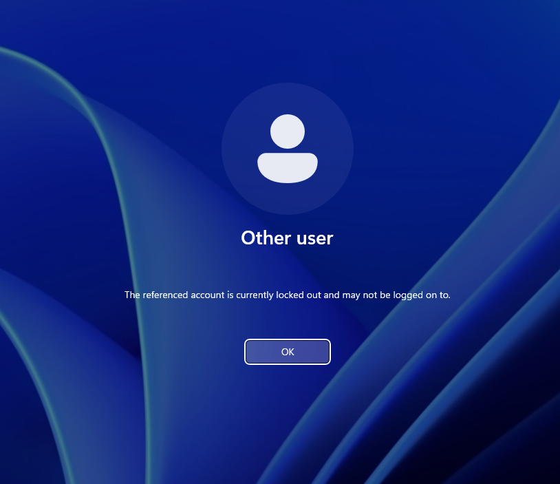
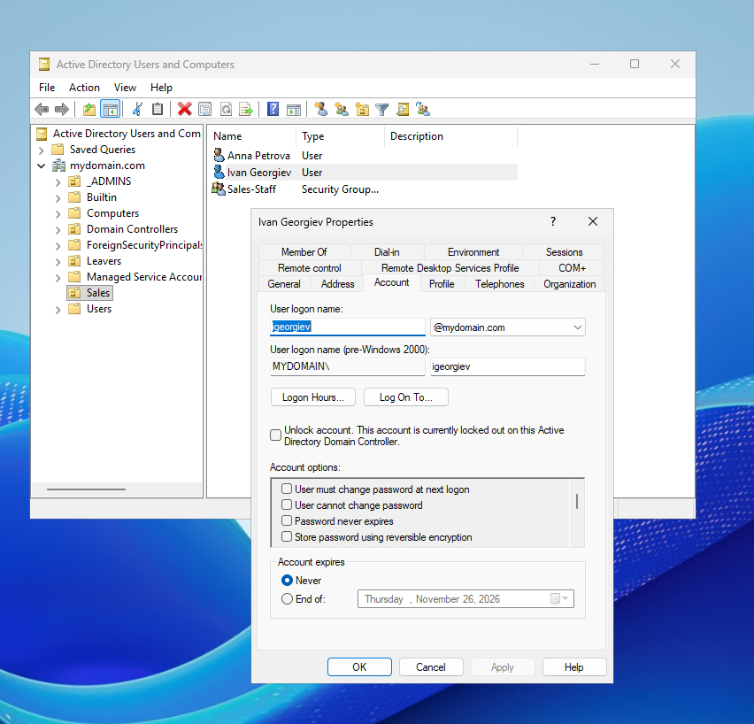
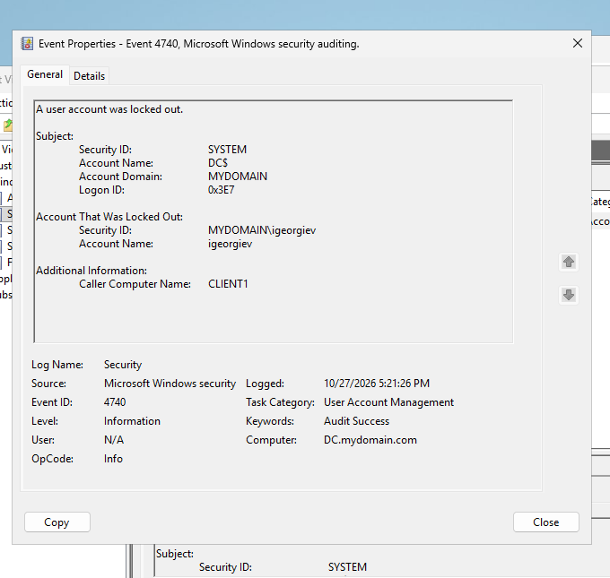
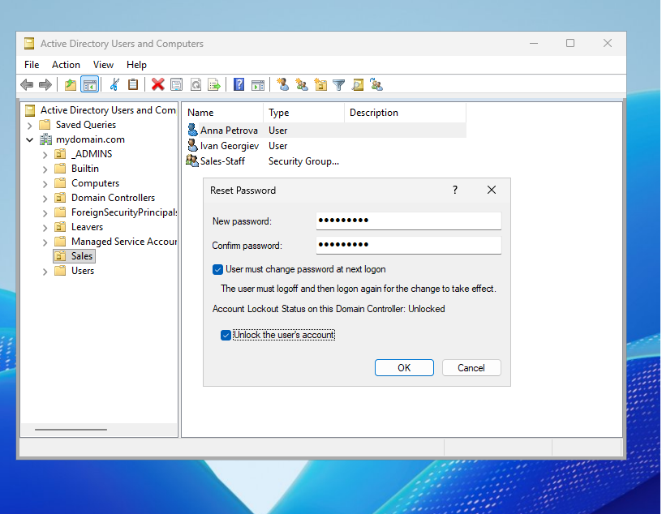

# Password reset and account unlock in Active Directory

"I can't log in" is a ticket you'll handle more than almost any other. It usually means one of two things: the account is **locked out**, or the user has **forgotten their password**. They're different problems, with different fixes.

I set up the examples here in my own lab, with a domain controller and a Windows 11 client, where I managed all of the accounts involved.

## First, verify the caller

Before you even touch the account, make sure the person on the phone is who they say they are. A password reset hands someone access to an account, which is exactly what an attacker might want.

Call the employee back on the number on file, ask for their employee ID, or confirm the request with their manager. Recognising the voice isn't enough, especially nowadays, when a voice can be convincingly copied from just a few seconds of recorded audio.

## Locked out or forgotten?

A lockout happens after too many wrong passwords in a row. In my lab, I set the limit to 5. A locked-out user may still know their correct password, so all they might need is an unlock. Make sure you confirm this with them.

*Each wrong attempt counts towards the lockout limit.*

## Unlocking an account

Open **Active Directory Users and Computers**, find the user, open their properties and go to the **Account** tab. Tick **Unlock account** and click **OK**.

*What the user sees when the account is locked.*

*The Account tab, showing the account is locked out.*

Once it's unlocked, ask the user to sign in while you're still on the call, using their existing password.

## Finding the cause

Unlocking fixes the immediate issue, but if something keeps sending the old password, the account will lock itself again within minutes.

If auditing of account changes is turned on, open **Event Viewer on the domain controller**, go to the **Security** log, and filter for **Event ID 4740**. Each result records a lockout, and its **Caller Computer Name** tells you which device sent the bad passwords.

*Event 4740, with the device that caused the lockout.*

The typical culprits are a mail app on a phone, saved credentials in Windows Credential Manager, a mapped drive, or a forgotten Remote Desktop session.

Fix the source, unlock the account, and check a few minutes later that it's still unlocked.

## Resetting a password

If the user genuinely doesn't know their password, reset it. Right-click the user, choose **Reset Password**, enter a temporary password, and tick **User must change password at next logon**. If the account is also locked, tick **Unlock the user's account** in the same window. The forced change means the user ends up as the only person who knows their password.

*The Reset Password window.*

*At the next sign-in, Windows asks for a new password.*

Give the temporary password to the user over the phone, or through their manager. Never put it in the ticket, or, even worse, in an email: both are stored and read by other people.

Only reset when there's an actual need. Resetting a password for a simple lockout means the user has to update it on every device and app they use, a step they didn't need.

## Writing up the ticket

Your note should let the next analyst understand what happened without having to contact you. Include how you verified the caller, what you found (the nature of the issue and its cause), what you did, and how you confirmed it worked.

## Summary

1. Verify the caller properly.
2. Ask whether they know their password.
3. **Locked out:** unlock, find the cause with Event 4740, check it stays unlocked.
4. **Forgotten:** reset with a temporary password and a forced change.
5. Share the temporary password by phone or through the manager only.
6. Write a clear ticket note.

Many companies now let users reset their own passwords after confirming their identity with MFA (**self-service password reset**), which removes this ticket entirely.
