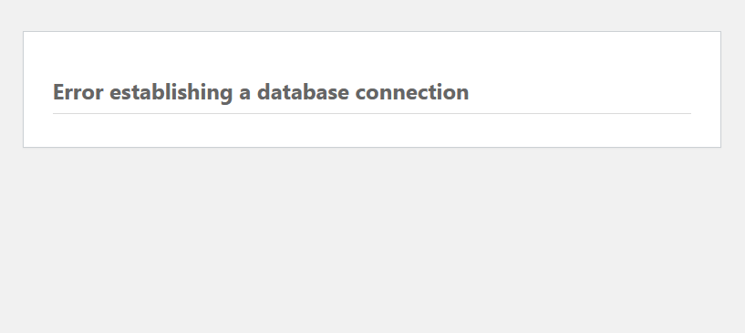
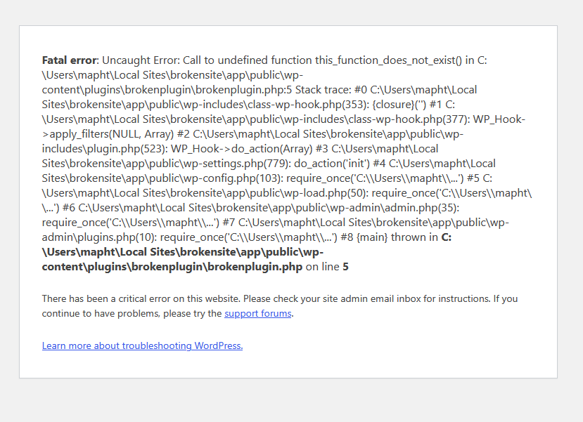

# Four common WordPress errors and how to fix them

WordPress runs a huge share of the web, so its errors fill a good part of any hosting support queue. This guide covers four of the most common ones. The examples come from a website I set up in a local lab and broke on purpose.

## How WordPress is built

A WordPress site has two halves: the **files** on the server, and a **database**. The files hold the code: WordPress itself, themes, plugins, and `wp-config.php`, which tells WordPress how to reach its database. The database holds the content: posts, settings and user accounts.

Almost every error lives in one of those halves, or in the link between them. Working out whether it's the files, the database or the connection gets you halfway to the answer.

## Before you touch anything

First, verify the customer, the same way you would for any account change. Then take a **backup**. Editing the database is risky, because there's no undo button, so export it before you change a single row.

## Error 1: "Error establishing a database connection"

The customer sees a plain white page with that one line. Nothing else loads, not even the admin area.

*The whole site reduced to one line.*

It means WordPress can't log in to its database. The most common cause is a mismatch between the details in `wp-config.php` and the real database. In my lab, it was the password.

To fix it, open `wp-config.php` and compare the four values (`DB_NAME`, `DB_USER`, `DB_PASSWORD`, `DB_HOST`) with their counterparts in the hosting control panel. Correct any mismatch and reload the site.

If `wp-config.php` is correct, look at the other two causes: the database server itself is down (then many sites are usually affected, not just one), or the database is damaged and needs repairing.

## Error 2: "There has been a critical error on this website"

The message sounds mild, but the problem usually isn't: the admin area often breaks too, so the customer can't fix it themselves.

*In my lab, the full error was shown. On a live server, visitors would only see the last line.*

Behind the message is a PHP error, most often caused by a plugin or a theme, and the full error message points to which one. Look at the file path: the folder name that comes after `plugins/` is the culprit.

On a real server, visitors never see the full error, for security reasons. To read it, add these three settings to `wp-config.php`: `WP_DEBUG` and `WP_DEBUG_LOG` set to `true`, and `WP_DEBUG_DISPLAY` set to `false`. WordPress then writes the details to `wp-content/debug.log`, where you can read them privately, without showing them on the website. Turn them off once you're done. In my lab's error above, the path ends in `plugins\brokenplugin\brokenplugin.php` on line 5, which names the culprit exactly.

The easiest fix is to **rename the faulty plugin's folder**, through the hosting File Manager or SFTP. WordPress can no longer find it, so it deactivates it automatically, and the site comes back. WordPress also emails the site's admin a **recovery mode** link, which lets them log in with the faulty plugin paused: useful when the customer has no file access.

## Error 3: The site redirects to the wrong address

The site doesn't load: every visit, including to the admin area, is sent to an address that doesn't exist, and the browser reports that the server can't be found.

This happens when a wrong URL is saved under **Settings → General**. Once that happens, the admin area follows the same wrong address, so you can't fix it from the place where it was broken.

The fix is in the database. Open phpMyAdmin (or a similar database tool), find the `wp_options` table, and edit the rows `siteurl` and `home`. Set both to the correct address, including the `https://`.

## Error 4: Locked out of WP Admin

The "Lost your password?" link on the login page is the obvious solution. If the email never arrives, or the address on the account is out of date, use the database: in phpMyAdmin, open `wp_users`, edit the user's row, type a new password into `user_pass`, and choose **MD5** from the function dropdown. The customer can then log in, and WordPress upgrades the password to a stronger hash on the first login.

Notice that you never see the old password. WordPress stores a **hash**, a one-way scramble of the password that can't be turned back into the original. That's why support can only reset a password, never read it.

## Summary

| Error | Likely cause | Fix |
|---|---|---|
| "Error establishing a database connection" | database details in `wp-config.php` don't match | correct them; if they match, check the database server |
| "There has been a critical error" | a faulty plugin or theme | find it in the error or `debug.log`, then rename its folder |
| Redirects to the wrong address | wrong URL saved in Settings | fix `siteurl` and `home` in `wp_options` |
| Locked out of WP Admin | lost password, reset email not arriving | reset `user_pass` in `wp_users` with MD5 |
