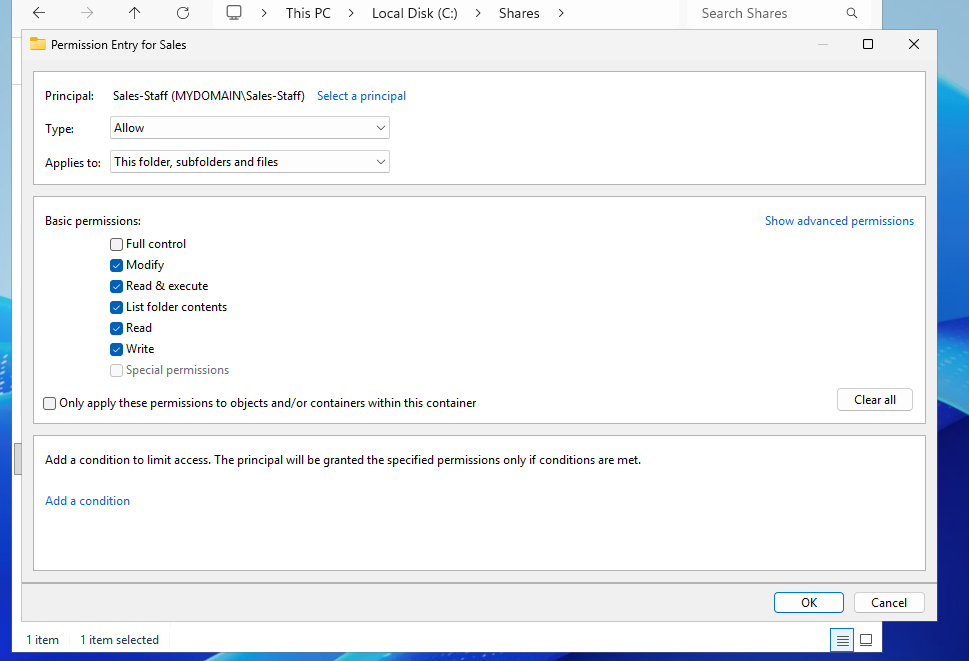
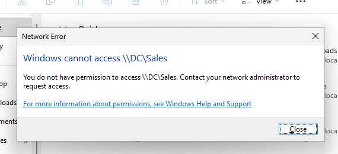
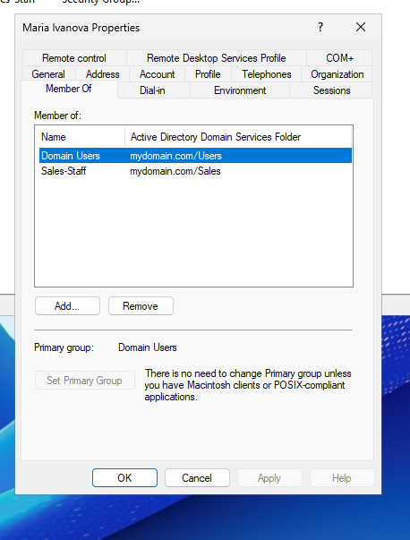
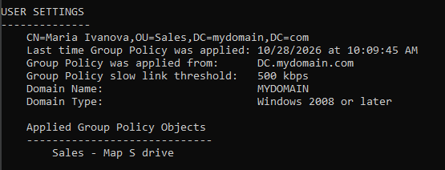

# "Access denied" on a shared folder: permissions and mapped drives

"I can't open the shared folder" is one of the most common tickets you'll get, especially when someone new joins a team.

The examples come from my home lab: a domain controller, a shared Sales folder, and a new starter, Peter, who couldn't open it.

## How shared folders work

A shared folder lives on a server and is reached by a network path, written like this: `\\server\Sales`. The two backslashes mean "a location on the network", followed by the server's name and then the name of the share.

A **mapped drive** is just a shortcut to that path. Instead of typing `\\server\Sales`, the user sees a drive letter, such as **S:**, in File Explorer.

## Two locks: share and NTFS permissions

Every shared folder has two sets of permissions. **Share permissions** apply only when someone connects over the network. **NTFS permissions** are set on the folder itself, in the **Security** tab, and apply whether you connect over the network or sit at the server.

Over the network, both apply, and **the stricter one always wins**. If the share says Full Control but NTFS says Read, the user can only read.

That's why most companies keep the share fairly open and do the real control through NTFS, using **groups** rather than individual users. You give the Sales-Staff group access once, and from then on, managing access just means managing who's in the group.

*The NTFS permission entry for the Sales folder: Sales-Staff has Modify.*

## Working the ticket

It's Peter's first day, and when he opens the Sales folder, he gets an "Access denied" message. The folder exists, but he isn't allowed in.

*What Peter sees when he opens `\\DC\Sales`.*

**First, find out whether it's just him or the whole team.** If it's everyone, look at the server or the share. Only Peter was affected, so it's about his account.

**Next, check he's using the right path.** "Access denied" is actually a good sign here: it means he reached the folder, but wasn't let in.

**Then check his group membership.** In Active Directory, open Peter's account and look at the **Member Of** tab. He wasn't in Sales-Staff, which is normal for a new starter whose setup wasn't finished. A correctly set-up Sales colleague, for comparison:

*Maria's Member Of tab: Domain Users and Sales-Staff.*

**To be certain, check Effective Access.** Open the folder's **Advanced Security Settings**, go to **Effective Access**, and check Peter's account. It shows what he can actually do once every permission is combined. In this case, it confirmed he had no rights to the folder.

**Don't add him straight away.** Access to a team's files should be approved by the folder's owner or his manager, and the approval goes in the ticket. Once approved, add him to Sales-Staff.

**Group membership is read when you sign in,** so Peter won't get access until he logs off and back on. While you're still on the call, confirm he can open the folder.

## Mapped drives through Group Policy

Peter could now open `\\server\Sales`, but the S: drive still didn't appear in his File Explorer.

In my lab, the drive is mapped by a **GPO** (Group Policy Object), a set of rules applied at login. The GPO is linked to the **Sales OU**, the folder in Active Directory where the Sales team's accounts live. Anyone whose account sits in that OU gets the drive at login.

To pull the latest policies, run `gpupdate /force` on the user's computer, then `gpresult /r` to list which ones applied.

*`gpresult /r` for Maria, a Sales user: her account sits in OU=Sales, and "Sales - Map S drive" is listed as applied.*

The Sales GPO wasn't in Peter's list, because his account wasn't in the Sales OU. The fix is to move his account into the Sales OU, run `gpupdate /force`, and have him sign in again; the drive then appears.

The key lesson is that **groups and OUs do different jobs.** The group gives **access** to the folder; the OU decides which **settings** apply, like the mapped drive. Peter was in the right group but the wrong OU, so he could open the folder, but didn't get the drive.

## Summary checklist

1. **One user or everyone?** Everyone → check the server or the share. One → check the user.
2. **Check the path.** "Access denied" means the folder was reached.
3. **Check group membership** (Member Of), and confirm with **Effective Access**.
4. **Get approval** before granting access, and note it in the ticket.
5. **Add the user to the group**, then have them **log off and on**.
6. **Drive missing?** Check the user's **OU**, run `gpupdate /force`, and confirm with `gpresult /r`.
7. **Confirm with the user**, and document the ticket.
